<div align="center">

# NAVER WORKS Clone · Backend

### 메신저 · 주소록 · 게시판 · 알림을 실시간으로 잇는 협업 서비스의 서버


`Backend` · `개인 포트폴리오` · [Frontend 저장소 →](https://github.com/wjsgusdn12/naver_works_clone_front)

</div>

> 네이버웍스의 협업 기능을 참고해 직접 설계한 개인 프로젝트입니다. 실제 서비스의 코드나 디자인을 가져오지 않았습니다.

---

## 1. 한눈에 보기

<!-- diagram: overview -->
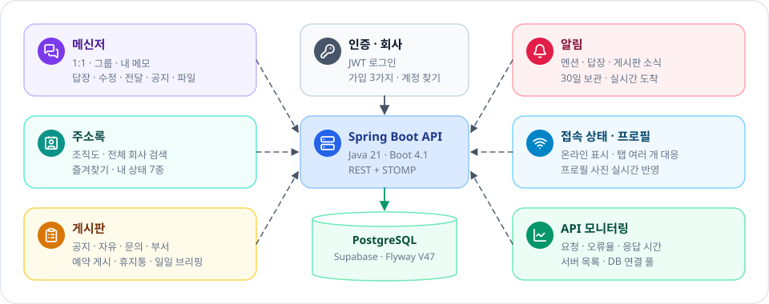

서버 하나가 여섯 가지 기능을 맡고, 모든 데이터는 PostgreSQL 한곳에 모입니다.

---

## 2. 전체 구조

<!-- diagram: architecture -->
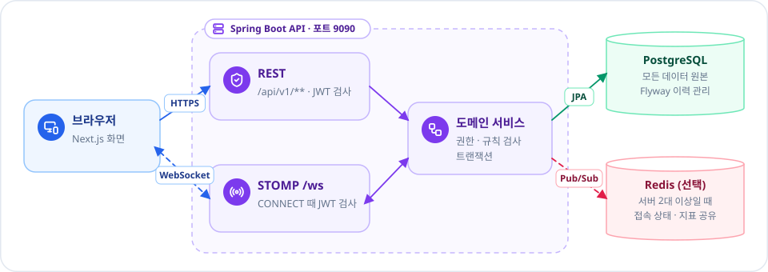

화면은 REST(조회·저장)와 WebSocket(실시간 소식) 두 길로 서버와 대화합니다.

---

## 3. 로그인과 세션

<!-- diagram: auth -->
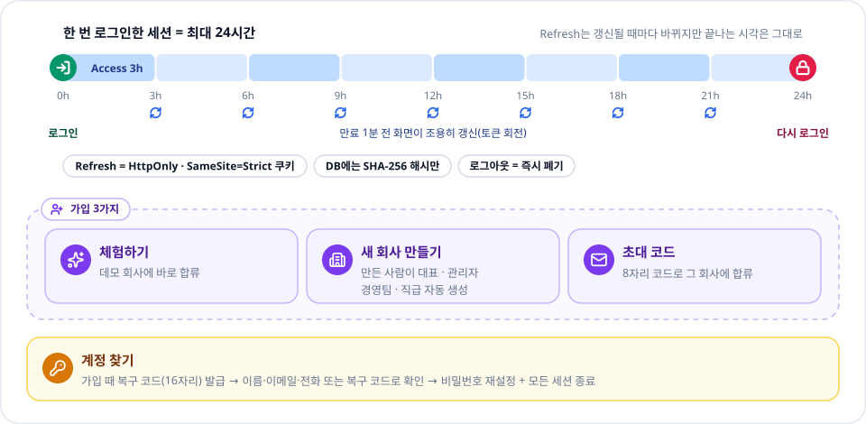

Access 토큰은 3시간마다 바뀌지만 세션은 로그인 후 24시간이면 반드시 끝납니다.

---

## 4. 데이터 모델

<!-- diagram: data-model -->
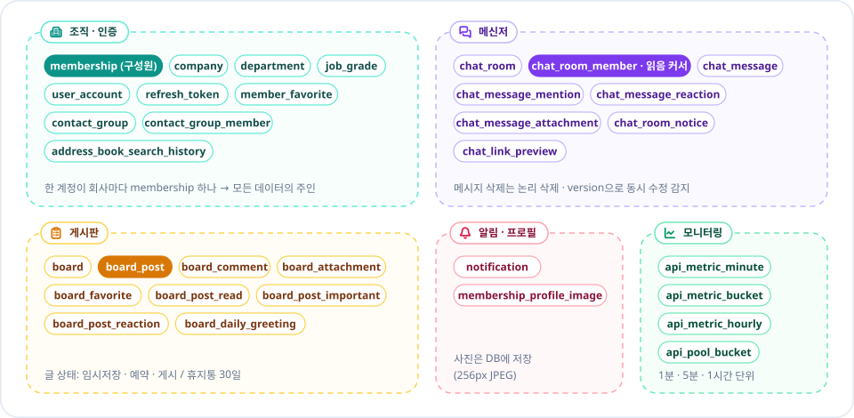

회사마다 하나씩 생기는 `membership`(구성원)이 메시지·글·알림의 주인입니다.

---

## 5. 메시지가 전달되는 길

<!-- diagram: message-flow -->
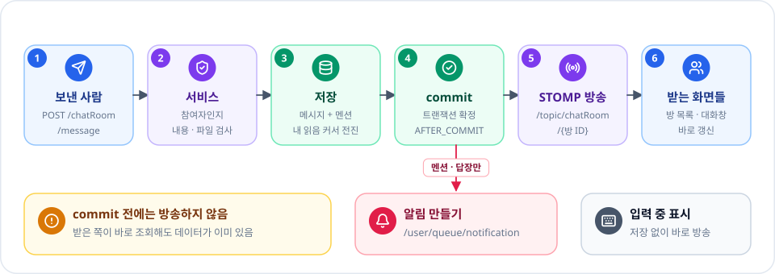

저장이 확정(commit)된 뒤에만 방송해서, 소식을 받은 화면이 조회하면 데이터가 늘 있습니다.

---

## 6. 읽음 수 계산

<!-- diagram: read-cursor -->
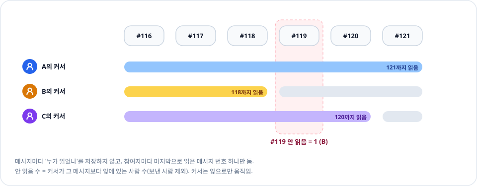

참여자마다 "어디까지 읽었나" 번호 하나만 저장하고, 안 읽음 수는 그 번호로 셉니다.

---

## 7. 메시지 기능

<!-- diagram: message-features -->
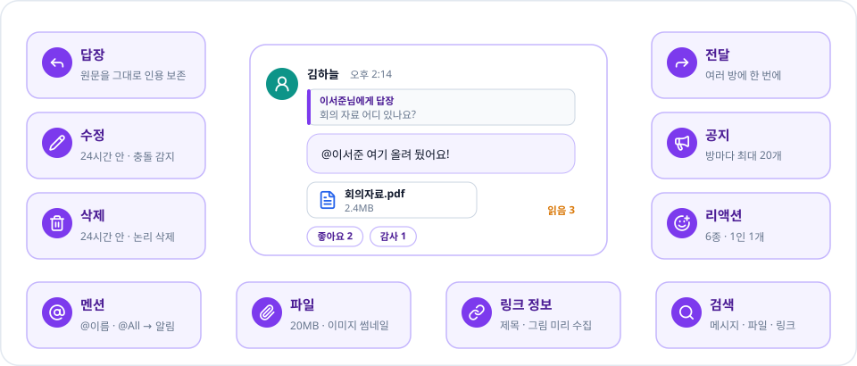

수정·삭제·리액션은 24시간 안에만 되고, 권한은 모두 서버가 다시 확인합니다.

---

## 8. 알림 규칙

<!-- diagram: notification-rules -->
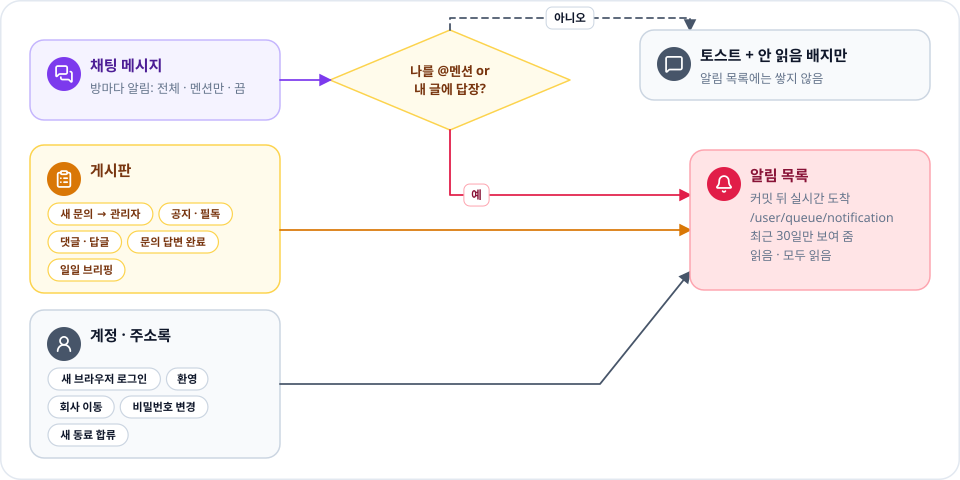

일반 메시지는 토스트와 배지로 끝내고, 나를 부른 메시지와 게시판·계정 소식만 알림 목록에 쌓습니다.

---

## 9. 접속 상태

<!-- diagram: presence -->
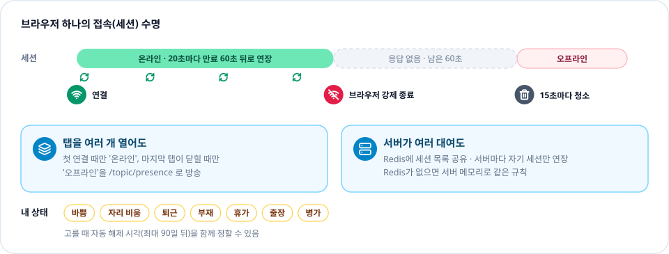

브라우저가 갑자기 꺼져도 60초 만료로 저절로 오프라인이 됩니다.

---

## 10. 게시판

<!-- diagram: board -->
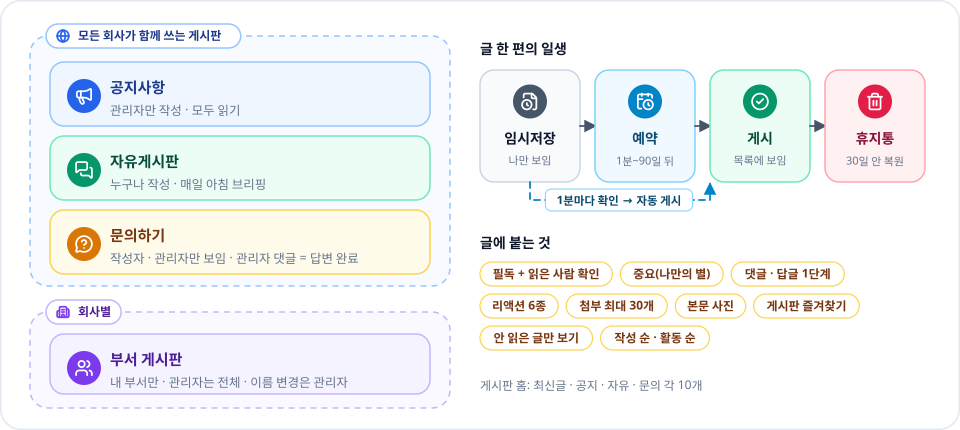

공지·자유·문의는 모든 회사가 함께 쓰고, 부서 게시판은 자기 부서만 봅니다.

---

## 11. 일일 브리핑

<!-- diagram: daily-briefing -->
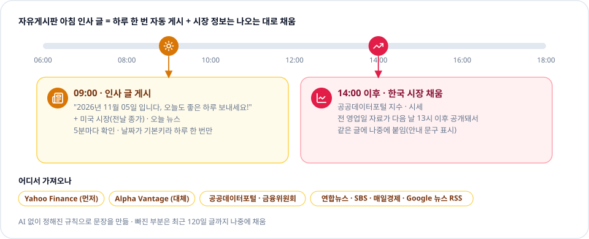

아침 9시에 인사 글이 올라가고, 한국 시장 자료는 공개되는 오후 2시 이후 같은 글에 채워집니다.

---

## 12. API 모니터링

<!-- diagram: monitoring -->
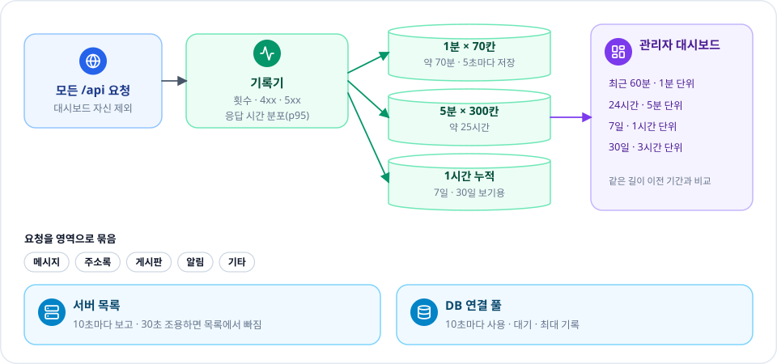

모든 요청을 1분·5분·1시간 단위로 모아, 관리자 화면에서 60분부터 30일까지 봅니다.

---

## 13. 서버 여러 대

<!-- diagram: scale-out -->
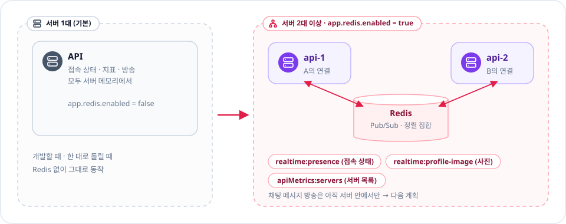

설정 하나(`app.redis.enabled`)로 서버 메모리 방식과 Redis 공유 방식을 바꿉니다.

---

## 14. 패키지 구조

<!-- diagram: packages -->
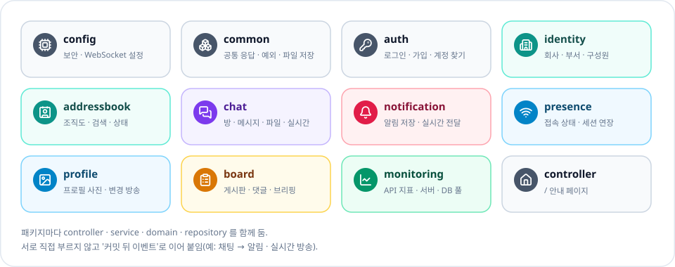

기능별 패키지 안에 controller·service·domain·repository를 함께 둡니다.

---

## 15. 다음 계획

<!-- diagram: roadmap -->
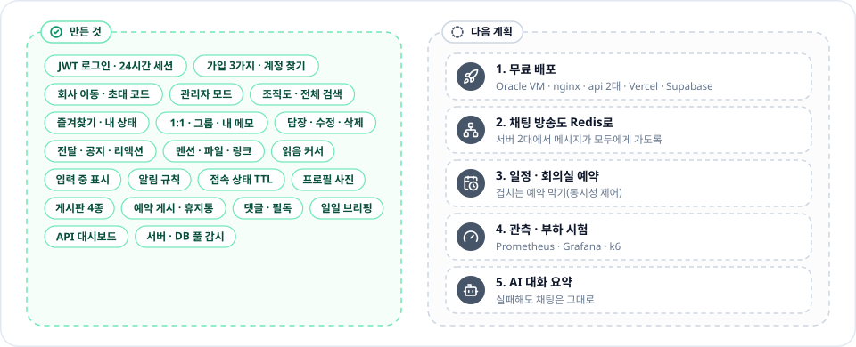

왼쪽은 지금 동작하는 기능, 오른쪽은 아직 만들지 않은 계획입니다.

---

## 기술 스택

| 분류 | 사용 |
| --- | --- |
| 언어 · 프레임워크 | Java 21 · Spring Boot 4.1 · Spring MVC |
| 인증 | Spring Security · JWT(HS256) · BCrypt |
| 데이터 | Spring Data JPA · Flyway · PostgreSQL(Supabase) |
| 실시간 | WebSocket · STOMP · Redis Pub/Sub(선택) |
| 테스트 | JUnit 5 · Spring Boot Test · H2 |

## 로컬 실행

```powershell
# application-local.yml.example 을 복사해 application-local.yml 을 만들고 값을 채움(Git 제외)
$env:SPRING_PROFILES_ACTIVE = "local"
.\mvnw.cmd spring-boot:run     # http://localhost:9090

.\mvnw.cmd test                # H2로 테스트
```

DB 비밀번호와 JWT 키는 환경변수나 로컬 설정 파일에만 둡니다.

## 그림 다시 만들기

```powershell
node scripts/build-readme-art.mjs     # docs/diagrams/*.svg + docs/guide.json
```

그림 모양은 `scripts/readme-art/diagrams.mjs`, 제목과 한 줄 설명은 이 README가 원본입니다. 프론트 앱의 "프로젝트 소개" 창이 같은 파일을 보여 줍니다.
